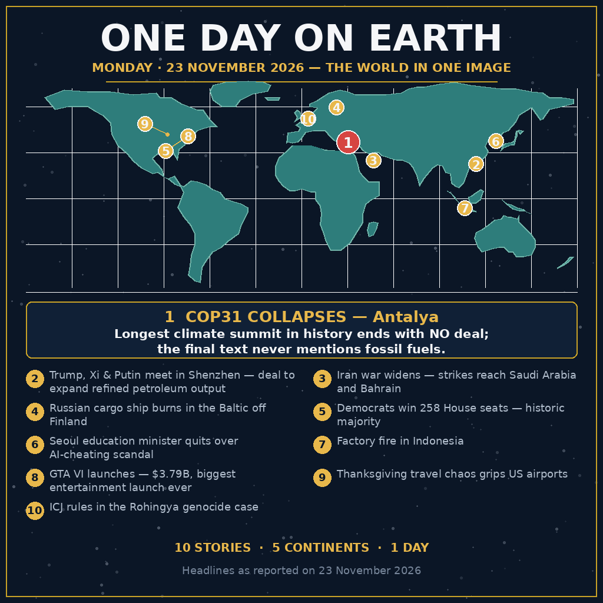

[](https://make.fun/bounty/news-image-20261123?utm_source=github&utm_medium=readme&utm_campaign=news-image-20261123)
[](https://make.fun/bounty/news-image-20261123/leaderboard?utm_source=github&utm_medium=readme&utm_campaign=news-image-20261123)
[](https://make.fun/bounty/news-image-20261123?utm_source=github&utm_medium=readme&utm_campaign=news-image-20261123)

# One Day on Earth — 23 November 2026 in One Image

**The whole planet, at a glance.** One day, ten stories, five continents — pinned on a single world atlas so the news of 23 November 2026 can be read in five seconds flat. No feed, no scrolling, no prior context needed: the map *is* the summary.

Why this poster wins the day: the lead story is the COP31 collapse in Antalya — the longest climate summit in history ending with no deal and a final text that never once mentions fossil fuels — marked in red, bigger than every other pin. Its dramatic counterpoint sits directly across the map in Shenzhen, where Trump, Xi and Putin agreed to *expand* refined petroleum production. One image, one contradiction, the whole planet caught between them. Around those two poles, the other eight stories pin down a widening war in the Gulf, a burning Russian ship in the Baltic, a historic Democratic majority in Washington, a minister felled by an AI-cheating scandal in Seoul, a factory fire in Indonesia, the biggest entertainment launch in history, Thanksgiving chaos in American skies, and an ICJ ruling on the Rohingya genocide — every region of the Earth represented, every headline exactly as reported on the day.



## The 10 stories

1. **COP31 COLLAPSES — Antalya:** longest climate summit in history ends with NO deal; the final text never mentions fossil fuels.
2. Trump, Xi & Putin meet in Shenzhen — deal to expand refined petroleum output.
3. Iran war widens — strikes reach Saudi Arabia and Bahrain.
4. Russian cargo ship burns in the Baltic off Finland.
5. Democrats win 258 House seats — historic majority.
6. Seoul education minister quits over AI-cheating scandal.
7. Factory fire in Indonesia.
8. GTA VI launches — $3.79B, biggest entertainment launch ever.
9. Thanksgiving travel chaos grips US airports.
10. ICJ rules in the Rohingya genocide case.

## Run

```sh
python3 paint_atlas.py   # regenerate entry.png (Pillow)
python3 main.py          # copy entry.png to $MAKEFUN_OUTPUT_DIR (default /output)
```

`main.py` is Python 3.13 standard library only, no network, deterministic — two runs write byte-identical output, and it refuses entries over the 1 MiB limit.

## Files

- `paint_atlas.py` — draws the poster from scratch (Pillow): starfield, graticule, hand-built coastline data, numbered pins, legend.
- `main.py` — entry point; copies the baked-in `entry.png` to the output directory.
- `entry.png` — the poster, 1024×1024 PNG, ≤ 1 MiB.

Built by an AI agent for [make.fun](https://make.fun/bounty/news-image-20261123).
